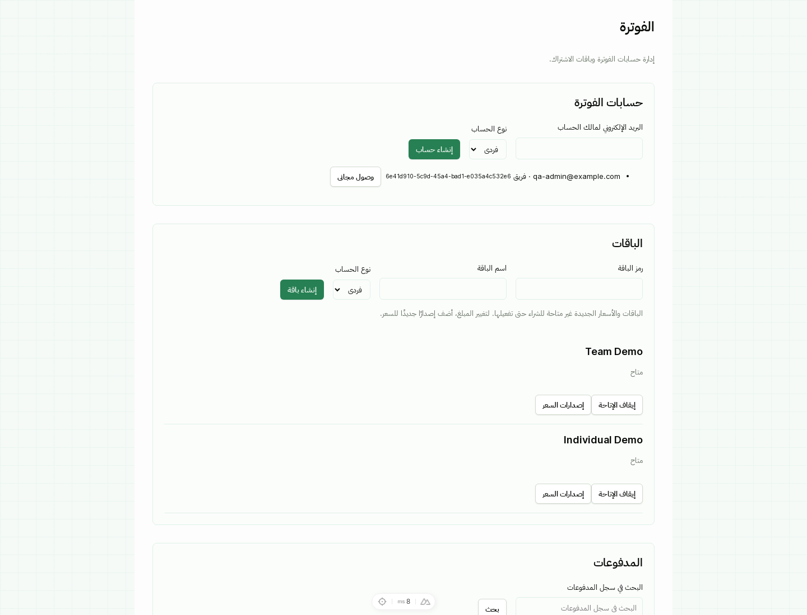
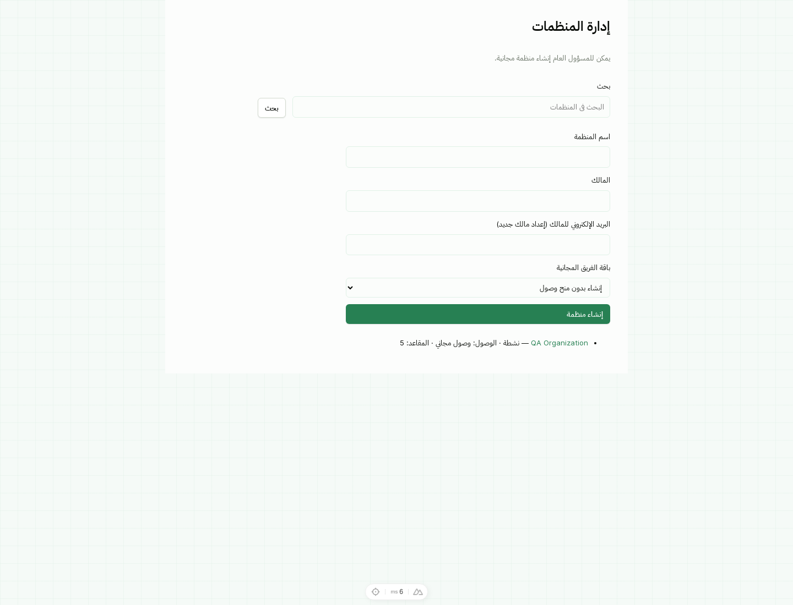
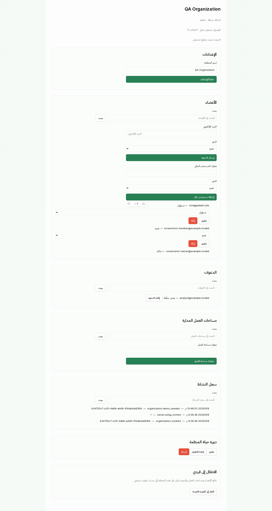

# Jadawl billing and OrgTeam administrator manual

This guide covers the separate `jadawel_billing` and
`jadawel_organizations` plugins. A paid order is activated only after the
server verifies Moyasar's payment. Complimentary access is an audited
entitlement and never pretends that a payment occurred.

## Install and configure

Install Billing first, then Organizations, and run the normal Jadawl migration
command:

```bash
uv pip install ./plugins/jadawel_billing/backend ./plugins/jadawel_organizations/backend
export JADAWEL_PLUGIN_DIR="$PWD/plugins"
export ADDITIONAL_MODULES="$PWD/plugins/jadawel_billing/web-frontend/modules/jadawel-billing/module.js,$PWD/plugins/jadawel_organizations/web-frontend/modules/jadawel-organizations/module.js"
```

Configure `JADAWEL_MOYASAR_SECRET_KEY`,
`JADAWEL_MOYASAR_PUBLISHABLE_KEY`, `JADAWEL_MOYASAR_WEBHOOK_SECRET`,
`JADAWEL_BILLING_MODE`, and `JADAWEL_BILLING_LIVE_ENABLED` outside the
repository. Keys must use the selected `test` or `live` prefix. Missing keys do
not block complimentary administrator access. Never send card numbers, CVCs,
or secret keys to Jadawl; the browser sends card details directly to Moyasar.

## Verified local screens

These screenshots were captured on 2026-09-08 from the local QA stack with
Moyasar credentials absent. They use synthetic fixture identities and show the
Arabic RTL layout, shared Jadawl forms and buttons, billing administration,
organization provisioning, membership controls, invitations and audit history.







## Create an organization without payment

**Admin → Organizations** sets an organization up in one step, with no
invitation for anyone to accept:

1. Enter the organization name and the owner's email.
2. Choose **Add member** for each member, enter their email and choose
   **Member** or **Administrator**.
3. Choose the complimentary Team plan. The seat limit defaults to the owner
   plus every member; enter a larger number to leave room. Expiry and reason
   are optional.
4. Keep **Create a workspace for the organization** checked to create a
   workspace with the organization's name, bound to it, where the owner and
   administrators are workspace administrators and members are workspace
   members.
5. Choose **Create organization**.

Everyone is a member the moment the request succeeds. An email that already
has an active account is added to that account. An email with no account gets
one on the spot, marked as verified, with a generated temporary password. The
passwords are shown once under the form, with **Copy emails and passwords**;
hand them over, and ask each person to change theirs after signing in. They
are not stored in clear text, so a retried request cannot show them again. A
deactivated account, or the same email twice, rejects the whole request and
nothing is created.

The form calls `POST /api/organizations/admin/setup/`, which accepts the
`Idempotency-Key` header and answers with `Cache-Control: no-store`.

The older `POST /api/organizations/admin/create/` remains for API clients: it
takes an owner user ID or email, and for an email with no account it leaves the
organization pending, reserves the owner seat and emails a restricted setup
invitation. The response carries a one-time setup token, which a general
administrator can rotate or reassign with
`POST /api/organizations/admin/{id}/owner-setup/`. Its access grant is set
separately under **Billing → Complimentary access**.

The owner counts as one Team seat. A complimentary organization can be created
without a plan first, but member additions remain restricted until a paid
subscription or valid manual grant supplies capacity. Repeat requests can use
the API's `creation_key` to return the same organization safely.

## Start a paid Team organization

1. A signed-in payer opens **Organizations**, enters a name, and chooses
   **Create organization**.
2. Jadawl creates a pending Team account and sends the payer to **Billing**.
3. Select the Team price and purchased seats. The server calculates the quote
   as `price amount × seats` in SAR halalas.
4. Submit card details through Moyasar, then return to **Verify payment** if the
   redirect or webhook is delayed.

Only a verified `paid` or `captured` payment changes the order and subscription
state. Reconciliation provisions the organization idempotently; retrying a
settled order cannot create a second organization.

During checkout, **Save this card for subscription renewal** is an explicit
opt-in. Moyasar tokenizes the card directly. Jadawl stores only the verified
provider token reference and safe display details; after a 3-D Secure return,
the server derives the token from the verified payment before saving it. The
customer can remove a saved method from **Billing → Payment methods** at any
time, which revokes it for future renewals.

## Edit, extend, or revoke access

Open **Billing → Complimentary access** for the account. Use preview to review
plan, seats, start/expiry, the current paid renewal, and the resulting effective
source before saving. The capacity lock rejects a cap below occupied seats;
resolve members first rather than evicting them implicitly.

Set a later expiry to extend access, or use **Revoke grant** with a reason. The
account falls back to a valid paid subscription or **Restricted** access. Grant
changes do not refund a payment or silently cancel a paid renewal. **Suspend
account access** overrides both manual and paid access until restored.

## Manage people

Use the search field in each list to find an organization, member, invitation,
or workspace. Long lists load additional pages with **Load more**.

From an organization detail page, an owner, administrator, or general admin
can:

- **Add existing user** using the user's ID and the Member or Administrator
  role. This never creates a second identity.
- **Send invitation** to a verified email. The token is hashed at rest, expires
  after seven days, and is sent after the transaction commits.
- Review **Invitations** and **Revoke invitation**. Resending an address revokes
  the previous pending token before issuing a new one.
- Suspend/reactivate or remove a member. Suspension keeps the seat reserved and
  removes managed workspace access; removal releases the seat and retains audit
  and payment history.

An administrator cannot appoint another administrator or remove an
administrator. Only the owner or general admin can transfer ownership. The
owner cannot be suspended or removed; transfer ownership to an active member
first.

## Accept an invitation

The invited user signs in with the matching email and opens
`/organizations/invitations/accept`, pastes the token, and chooses **Accept
invitation**. Expired, revoked, replayed, or mismatched-email tokens are
rejected. Acceptance locks and rechecks Team capacity, so two users cannot
consume the last seat concurrently.

## Bind workspaces and assign access

1. In the organization detail page, enter a workspace ID and choose **Bind
   workspace**.
2. Review the binding preview for existing workspace outsiders and pending
   invitations. A non-staff manager cannot bind a workspace with unresolved
   outsiders; a general admin must explicitly review it.
3. For each binding, choose an active organization member and choose **Assign**.
   Choose **Workspace administrator**, **Workspace member**, or **Viewer** for
   the assignment. Viewer access is read-only, and is enforced by the backend.
   Use **Remove workspace access** on an assignment to unassign that member while
   keeping their organization membership.
4. Use **Unbind workspace** only after reviewing who should retain independent
   access. Unbinding removes access created by the organization adapter and
   preserves unrelated personal workspace data.

Organization permission enforcement also applies to core workspace operations and
API-token actors. A general administrator must submit an explicit outsider
confirmation after reviewing the binding preview; the server rejects a bind with
unresolved outsiders unless that confirmation is present.
Members retain allowed reads during a billing grace period, while writes,
invites, publishing, and new workspace creation are denied after access becomes
restricted. Public links and personal workspaces are not deleted by member
removal.

## Suspend, reactivate, archive, and transition

Use the lifecycle controls after reviewing the effect:

- **Suspend** changes the organization state and immediately removes managed
  workspace access while preserving data and seats.
- **Reactivate** restores active members' managed access after entitlement and
  organization checks.
- **Archive** is a retained administrative state; it has no permanent delete
  action in v1.
- **Transition to personal** is available to an owner after all other members
  and workspace bindings are explicitly resolved. It creates or reuses the
  owner's Individual BillingAccount and archives the organization; it does not
  silently move or delete workspace data.

Stopping future paid renewal is a separate Billing action. Archiving or
revoking a grant does not issue a refund.

## Reconcile payments, refunds, and external payments

In **Billing → Payments**, inspect the order, mode, amount, currency, provider
reference, and attempt status. **Verify with Moyasar** performs a fresh
server-side fetch and checks all order metadata before activation. Provider
events are idempotent and retryable.

General admins can record a refund with a reason and validated amount. A refund
record keeps the original payment immutable and prevents duplicate processing.
Use **Record external payment** for an offline transfer; label it external and
unverified by Moyasar, and assign access separately. Do not count it as Moyasar
revenue or treat it as a tax invoice.

## Retention and removal

Removing either plugin does not delete billing, audit, organization, or workspace
records. Disable affected traffic, back up the database, run migrations before
restart, and keep the dependency order (Billing before Organizations). There is
no permanent account or data deletion control in v1.
